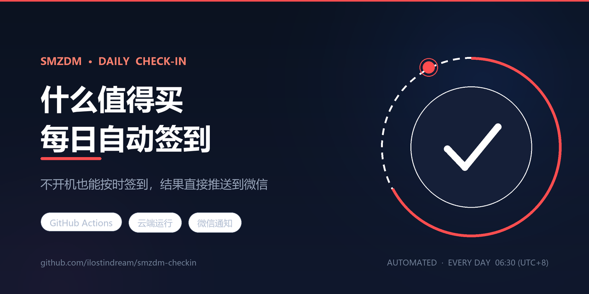

# 什么值得买 每日自动签到（GitHub Actions 版）



云端定时执行 smzdm 签到，无需电脑开机；签到结果通过微信推送。

| | |
|---|---|
| **运行方式** | GitHub Actions（云端执行，不依赖本地设备） |
| **执行时间** | 每天 08:50（北京时间），叠加 0–25 分钟随机延时 |
| **技术栈** | Python 3.11 · requests |
| **通知渠道** | PushPlus → 微信 |
| **成本** | 免费（公开仓库不消耗 Actions 额度） |
| **前置条件** | 一个 smzdm 账号的登录 Cookie |

## 目录

- [工作原理](#工作原理)
- [部署步骤](#部署步骤)
- [获取 Cookie](#获取-cookie)
- [Cookie 失效与更新](#cookie-失效与更新)
- [执行结果说明](#执行结果说明)
- [已知限制](#已知限制)
- [故障排查](#故障排查)
- [安全说明](#安全说明)

## 工作原理

```
GitHub Actions 定时触发 (UTC 00:50 / 北京 08:50)
        │
        ├─ 随机延时 0–25 分钟（打散执行时刻）
        │
        ├─ 步骤 1  校验 Cookie 登录态      → 失效则立即告警并退出
        ├─ 步骤 2  user-api 获取签到 token
        ├─ 步骤 3  checkin 接口执行签到
        │
        └─ PushPlus 推送结果到微信
```

本项目模拟 **Android 客户端** 完成签到。网页端签到接口已被官方废弃，仅用网页 Cookie 无法完成网页签到，因此签名与请求头均按 APP 端构造。

## 部署步骤

### 1. 创建仓库

仓库可见性有两种选择，按您的顾虑取舍：

| | 私有仓库 | 公开仓库 |
|---|---|---|
| Actions 额度 | 2000 分钟/月 | 不限 |
| 本任务月消耗 | 约 400 分钟（占 20%） | 0 |
| 日志可见性 | 仅自己 | **任何人可见** |
| 60 天无活动自动暂停定时 | **不适用** | **适用**，需点 `Enable workflow` 恢复 |
| 适用场景 | 重视隐私，额度够用即可 | 想分享方案，或不希望占用额度 |

**本仓库选择公开**，前提是代码已做日志脱敏（账号昵称显示为 `los***eam` 形式），且 Cookie 存放于加密 Secret 中、不随代码公开。

若您倾向私有，请留意额度消耗：脚本实际执行约 1 分钟，但定时触发会叠加 0–25 分钟随机延时（等待期间同样计费），平均每次约 13–14 分钟，每月约 400 分钟。如希望更省额度，可把 `checkin.yml` 中的 `RANDOM % 1500` 改为 `RANDOM % 600`（0–10 分钟），月消耗可降至约 165 分钟。

### 2. 上传文件

将本目录下所有文件上传到仓库根目录，注意保持目录结构：

```
├── .github/workflows/checkin.yml
├── checkin.py
├── requirements.txt
├── .gitignore
└── README.md
```

`.github/workflows/checkin.yml` 必须放在 `.github/workflows/` 目录下，否则 Actions 不会识别。

### 3. 配置 Secrets

进入仓库 → `Settings` → `Secrets and variables` → `Actions` → `New repository secret`，添加：

| Name | Value | 必填 |
|---|---|---|
| `SMZDM_COOKIE` | 从浏览器复制的 Cookie 字符串 | 是 |
| `PUSHPLUS_TOKEN` | PushPlus 的 token | 否（不填则不推送） |

Secret 名称必须完全一致，大小写敏感。GitHub 会加密存储，写入后无法查看明文，只能覆盖更新。

### 4. 启用 Actions 并手动测试

1. 进入仓库 `Actions` 标签页
2. 左侧选择 `SMZDM Daily Check-in`
3. 点击右侧 `Run workflow` → `Run workflow`
4. 等待约 1 分钟，查看运行日志与微信推送

首次运行成功即代表部署完成，之后无需任何操作。

## 获取 Cookie

1. 浏览器打开 `https://www.smzdm.com` 并登录
2. **必须**再访问 `https://zhiyou.smzdm.com/user/`（只有这个页面下发的 Cookie 才含完整登录态）
3. `F12` → `Network` → `F5` 刷新
4. 点击 `文档` 过滤标签，选中 `zhiyou.smzdm.com/user/` 这条请求
5. 右键 → `复制` → `以 cURL 格式复制 (bash)`
6. 用 `extract_cookie.py` 解析去重（见下）

> **关键提示**：浏览器里可能存在两条同名 `sess` Cookie（一条有值、一条为空）。直接整串粘贴会导致服务端读到空值而判定未登录。请先用工具清洗：
>
> ```bash
> python extract_cookie.py --paste
> ```

## Cookie 失效与更新

Cookie 是登录凭证，会因下列原因失效，**这是本方案唯一的长期维护成本**：

- 在浏览器主动退出登录
- 修改密码
- 长时间未登录导致会话过期
- 平台风控使会话作废

典型有效期：**数周至数月**，无法保证永久有效。

失效后的表现：Actions 运行标红，微信收到「签到失败：Cookie 已失效」通知。

**更新方法**：按上文重新获取 Cookie，到仓库 `Settings → Secrets` 中把 `SMZDM_COOKIE` 覆盖为新值。无需改动代码。

## 执行结果说明

| 状态 | 含义 | 是否需处理 |
|---|---|---|
| `SUCCESS` | 签到成功，附签到天数 | 否 |
| `ALREADY` | 今日已签到 | 否 |
| `COOKIE_INVALID` | Cookie 失效 | **是**，需更新 Secret |
| `RISK` | 请求过于频繁被限流 | 否，次日自动恢复 |
| `NETWORK` | 网络异常 | 否，次日自动恢复 |

## 已知限制

1. **仅公开仓库：60 天无任何仓库活动，GitHub 会自动暂停定时工作流。** 官方文档明确限定为 public repository（[schedule 事件说明](https://docs.github.com/en/actions/reference/workflows-and-actions/events-that-trigger-workflows#schedule)），**私有仓库不受此限，无需为规避它定期提交。** 本仓库当前为公开，因此这条适用：届时会收到邮件提醒，进入 Actions 页面点一下 `Enable workflow` 即可恢复；若不希望被打断，可每两个月提交一次改动（例如更新 README 中的日期）。
2. **定时触发不保证精确。** GitHub 官方说明 cron 在负载高峰时可能延迟，极端情况下可能跳过。已通过避开整点（08:50 而非 08:00）降低概率。
3. **签到接口依赖客户端签名，官方随时可能变更。** 若某天开始持续返回未知错误码，说明接口或签名规则变了，需要更新代码中的 `VERSION` 与 `SECRET` 常量。
4. 本方案仅完成**签到**，不含每日抽奖、浏览任务、众测等扩展功能。

## 故障排查

**Actions 运行失败，日志显示 401 或「请先登录」**
→ Cookie 失效，按「Cookie 失效与更新」重新配置。

**Actions 列表里没有这个工作流**
→ 检查 `.github/workflows/checkin.yml` 路径是否正确；或仓库 Settings → Actions → General 中的 Workflow permissions 需允许运行。

**签到成功但没收到微信通知**
→ 检查 `PUSHPLUS_TOKEN` 是否正确；登录 pushplus.plus 查看「一对一推送」的 token；确认微信已关注该公众号。

**本地测试**

```bash
pip install -r requirements.txt
export SMZDM_COOKIE="粘贴你的cookie"
export PUSHPLUS_TOKEN="你的token"
python checkin.py
```

Windows PowerShell：

```powershell
$env:SMZDM_COOKIE="粘贴你的cookie"
python checkin.py
```

## 安全说明

- Cookie 等同账号登录凭证，请勿提交到代码仓库、勿分享给他人
- 本项目仅通过环境变量读取 Cookie，不写入任何文件、不打印完整内容
- 建议以本任务专用的 Cookie 运行；如需彻底作废，在 smzdm 网页端退出登录即可使该 Cookie 立即失效
